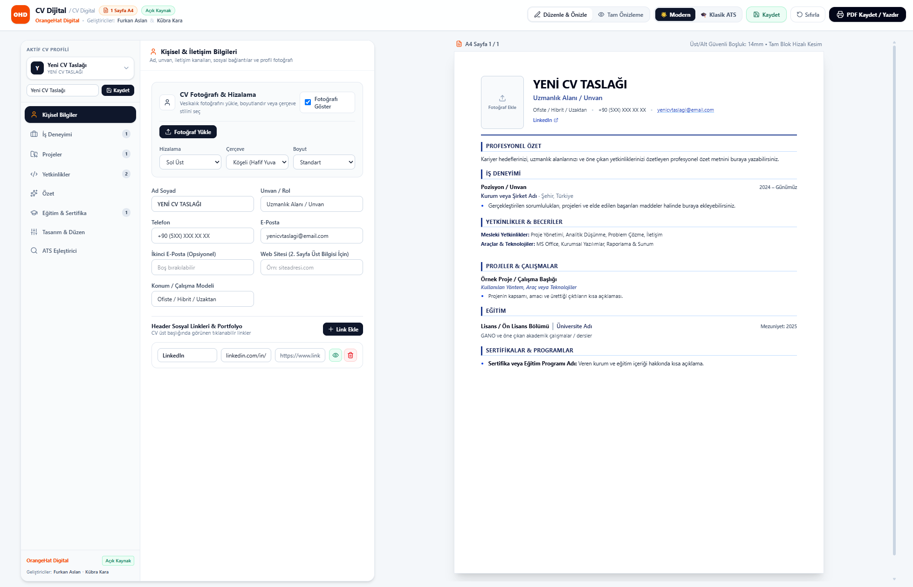

<div align="center">

# 📄 CV Dijital (CV Digital)

**Next.js & TailwindCSS ile Geliştirilmiş Açık Kaynak, Akıllı A4 CV Oluşturma Aracı**

[](https://nextjs.org/)
[](https://www.typescriptlang.org/)
[](https://tailwindcss.com/)
[](LICENSE)
[](#)

<p align="center">
  <b>CV Dijital</b>, geliştiricilerin ve profesyonellerin modern web standartlarında, ATS (Aday Takip Sistemi) uyumlu ve kusursuz A4 sayfa düzenine sahip özgeçmişler oluşturması için tasarlanmış tamamen ücretsiz ve açık kaynaklı bir platformdur.
</p>

[Özellikler](#-öne-çıkan-özellikler) • [Hızlı Kurulum](#-hızlı-kurulum) • [Mimari](#-proje-mimarisi) • [Yeni Profil Ekleme](#-yeni-cv-profili-ekleme) • [Geliştiriciler](#-geliştiriciler--marka)

<br /><br />



<p align="center">
  <sub>✨ <b>Çift Panelli Akıllı Mimari:</b> Sol panelde modüler form editörü, sağ panelde anlık milimetrik A4 sayfalama ve ATS önizlemesi.</sub>
</p>

</div>

---

## ✨ Öne Çıkan Özellikler

* 📄 **Akıllı A4 Sayfalama Motoru**: Sayfa taşmalarını, blok yüksekliklerini ve devam etiketlerini tarayıcı DPI'ına göre milimetrik hesaplar. Başlıkların veya deneyimlerin yarım yamalak bölünmesini engeller.
* 🎓 **Çift Şablon Desteği (Tek Tıkla Geçiş)**:
  * **Modern Tech**: Renkli sol vurgu barları, modern tipografi ve teknoloji etiketleri (Yazılım, SaaS ve Teknoloji odaklı).
  * **Klasik Harvard (Minimal ATS)**: Uçtan uca altı çizgili başlıklar, pipe (`|`) ayraçları ve sade siyah-beyaz zarafet (Uluslararası ATS tarayıcıları ve kurumsal şirketler için %100 uyumlu).
* 🎨 **Canlı Tasarım Stüdyosu**:
  * 10 seçkin kurumsal renk paleti (Antrasit, Derin Lacivert, Safir Mavi, Zümrüt Yeşili, Bordo, Amber vb.).
  * **Özel Renk Seçici (Color Picker & HEX)** ile istediğiniz herhangi bir kurumsal rengi seçebilme.
  * Serif / Sans-Serif yazı tipi seçimi ve sayfa marjin ayarı.
* 🔗 **Akıllı & İkonlu Bağlantı Formatı**: Upuzun link karmaşası yerine doğrudan `GitHub ↗`, `LinkedIn ↗`, `Google Play ↗`, `Canlı İncele ↗` etiketleri.
* 📁 **Doğrudan JSON Dosya Tabanlı CMS**: Tarayıcı çerezlerine veya LocalStorage'a bağımlı kalmadan, doğrudan `src/data/cvs/` altındaki gerçek `.json` dosyalarını okur ve günceller.
* 🌐 **Çoklu Profil & TR/EN Çift Dil Desteği**: Tek tıkla Türkçe ve İngilizce versiyonlar arasında tasarım tercihleri korunarak geçiş yapılabilir.
* 🖨️ **Kusursuz PDF & Yazdırma Çıktısı**: `@media print` optimizasyonu sayesinde tarayıcıdan doğrudan (`Ctrl + P`) vektörel, linkleri tıklanabilir ve tam A4 boyutunda PDF kaydeder.

---

## 🚀 Hızlı Kurulum

Projeyi yerel makinenizde çalıştırmak için Node.js (v18+) gereklidir.

```bash
# 1. Depoyu klonlayın
git clone https://github.com/orange-hat-X/cv-creator.git
cd cv-creator

# 2. Bağımlılıkları yükleyin
npm install

# 3. Geliştirme sunucusunu başlatın
npm run dev
```

Tarayıcınızda [http://localhost:3000](http://localhost:3000) adresine giderek uygulamayı anında kullanmaya başlayabilirsiniz.

---

## 🛠️ Üretim (Production Build)

```bash
# Üretim derlemesi oluşturun
npm run build

# Üretim sunucusunu başlatın
npm run start
```

---

## 📂 Proje Mimarisi

```text
cv-creator/
├── src/
│   ├── app/
│   │   ├── api/
│   │   │   └── cv/route.ts          # Canlı JSON dosya okuma & yazma API rotası
│   │   ├── cv-olustur/page.tsx      # CV oluşturucu ana sayfa rotası
│   │   ├── layout.tsx               # Kök layout ve SEO meta verileri
│   │   └── page.tsx                 # Ana yönlendirme sayfası
│   ├── components/
│   │   ├── CvBuilder.tsx            # Ana orkestrasyon bileşeni
│   │   └── cv-builder/
│   │       ├── editor/              # Sol düzenleme paneli ve sekmeler
│   │       │   ├── tabs/            # Kişisel, Deneyim, Proje, Yetkinlik sekmeleri
│   │       │   ├── EditorSidebar.tsx
│   │       │   └── ProfileSwitcher.tsx
│   │       ├── preview/             # Canlı A4 önizleme bileşenleri
│   │       │   ├── blocks/          # Header, Experience, Project, Skills blokları
│   │       │   ├── CvPageSheet.tsx  # A4 sayfa yaprağı (210mm x 297mm)
│   │       │   └── CvPreviewContainer.tsx
│   │       ├── hooks/
│   │       │   └── useCvPagination.ts # Akıllı A4 sayfalama ve yükseklik ölçüm motoru
│   │       ├── types/               # TypeScript tip tanımları
│   │       └── utils/               # Veri normalizasyon ve şablon araçları
│   └── data/
│       └── cvs/                     # JSON veri dosyaları ve profil tanımları
│           ├── furkan/              # Furkan Aslan CV verileri (TR / EN)
│           ├── kubra/               # Kübra Kara CV verileri (TR / EN)
│           └── index.ts             # Aktif profiller listesi
```

---

## 📝 Yeni CV Profili Ekleme

Kendi CV'nizi veya yeni bir kişiyi projeye eklemek son derece basittir:

1. `src/data/cvs/<kisi>/` klasörü altına `cvtr.json` dosyanızı oluşturun.
2. `src/data/cvs/index.ts` dosyasında import edip `CV_PROFILES` listesine ekleyin:

```ts
import yeniKisiTr from "./yenikisi/cvtr.json";

export const CV_PROFILES: CvProfileEntry[] = [
  {
    id: "yenikisi-tr",
    name: "Ad Soyad - Yazılım Geliştirici",
    updatedAt: "TR",
    lang: "tr",
    personKey: "yenikisi",
    filePath: "yenikisi/cvtr.json",
    data: yeniKisiTr,
  },
  // ... diğer profiller
];
```

Sistem otomatik olarak yeni profili algılar, açılır menüye ekler ve tüm düzenleme motorunu ona bağlar.

---

## 👨‍💻 Geliştiriciler & Marka

Bu proje [OrangeHat Digital](https://orangehatdigital.com.tr) bünyesinde açık kaynak topluluğu için geliştirilmiştir.

* **Topluluk & Organizasyon**: [OrangeHat Digital](https://orangehatdigital.com.tr)
* **Geliştirici**: [Furkan Aslan](https://furkanaslan.orangehatdigital.com.tr)
* **Geliştirici**: [Kübra Kara](https://kubrakara.vercel.app)

---

## 📜 Lisans

Bu proje [MIT Lisansı](LICENSE) kapsamında açık kaynak olarak yayınlanmıştır. Dilediğiniz gibi çatallayabilir (fork), kendi CV'nizi oluşturabilir ve projeye katkıda bulunabilirsiniz.
